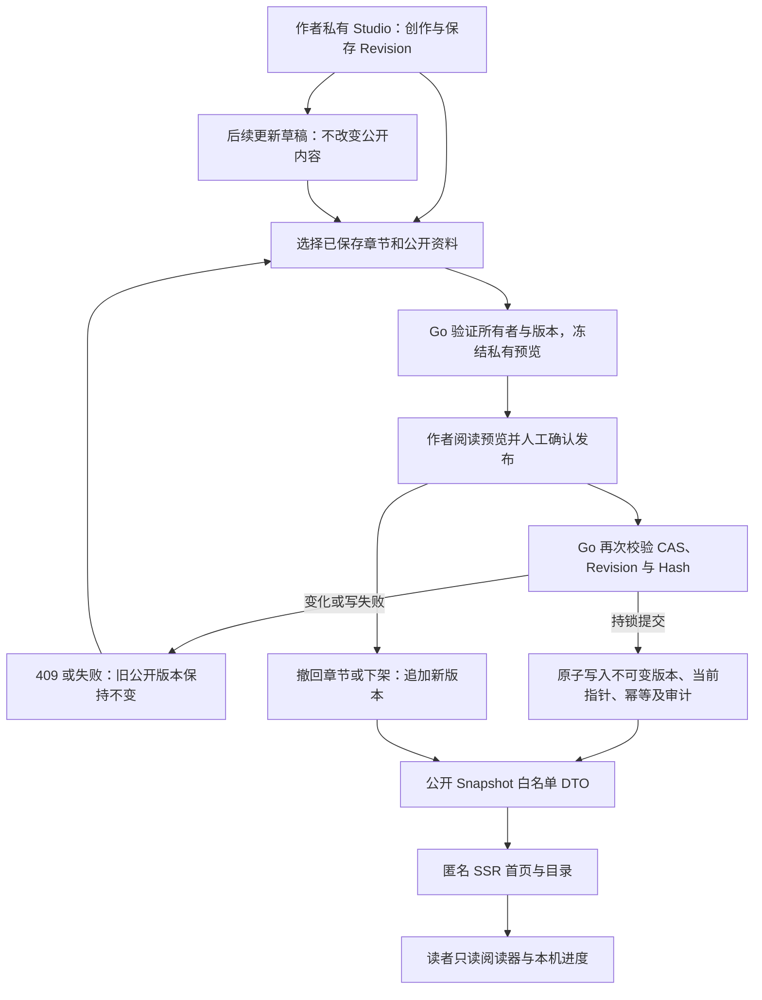

# 出版领域 V1

## 边界

`internal/publication` 复用 application.Actor 与现有 Go 文件锁。不引入身份系统、数据库、微服务或 Harness 写入。

在线作品通过受信任的 Managed Registry 动态解析 App 与所有者；旧兼容作品使用明确的服务端配置。所有者和文件路径不可由请求体指定。公开作者 slug 是随机 ID，与邮箱或私有用户 ID 无关。

## 状态与事务

应用状态目录 `publications/state-v1.json`，权限 0600。存放 Publications、只追加 Versions、暂存 Previews、幂等记录、公开作者 slug 映射和事务审计。该文件与 chapter-drafts、Notes、ReviewRun 分离。

单一 JSON 文件是出版事务边界：跨进程 O_EXCL 锁 → 读取与验证 → 创建不可变完整快照 → fsync → 原子 rename。写失败时旧文件保持完整。

锁顺序固定为出版全局锁，再按 chapterId 排序获取章节 draft 锁。发布重新验证当前 revisionId、contentHash、卷序、卷名和章节标题。

预览只接受章节身份与修订指纹。公开顺序来自 `OrderedChapters()`。提交采用 previewId + baseVersionId，任何变化均 409，必须重新预览和人工确认。

## 公开读取

匿名只读 `/v1/public/*`，仅从 currentVersionId 指向且 state=listed 的快照构造显式 DTO。没有读取私有 Harness、Revision、Notes、Review 的端点。内部 ID、hash、审计、预览不序列化。

所有公开与管理响应均 no-store。下架后新源站请求 404。

## 业务流程

## 管理摘要与内容时间

管理 GET 只传输章节指纹、标题、字数、空态及无正文的出版历史摘要。主动预览返回选中修订正文。完整 GET versions 为显式作者历史读取。

公开作品 `contentUpdatedAt` 由公开资料和章节内容变化推导。`publicationUpdatedAt` 记录最后操作。纯下架或重新上架不提升「最近更新」排序。

## 公开卷名

快照与公开章节 DTO 的可选 `volumeTitle` 保存作者预览并确认的卷名。未分卷的新快照使用显式空字符串；旧快照无字段时继续按编号显示，不从私有结构补填。修改草稿卷名使旧预览409，并进入待更新摘要，只有重新预览和发布才改变公开卷名与内容时间。历史版本保留原卷名。同名卷仍按快照卷序独立分组。

部署新增可选响应字段前，先让 Worker/Web 接受新旧响应，避免旧严格 DTO 拒绝未知字段；详见[部署指南](../deploy-guide.md)。
